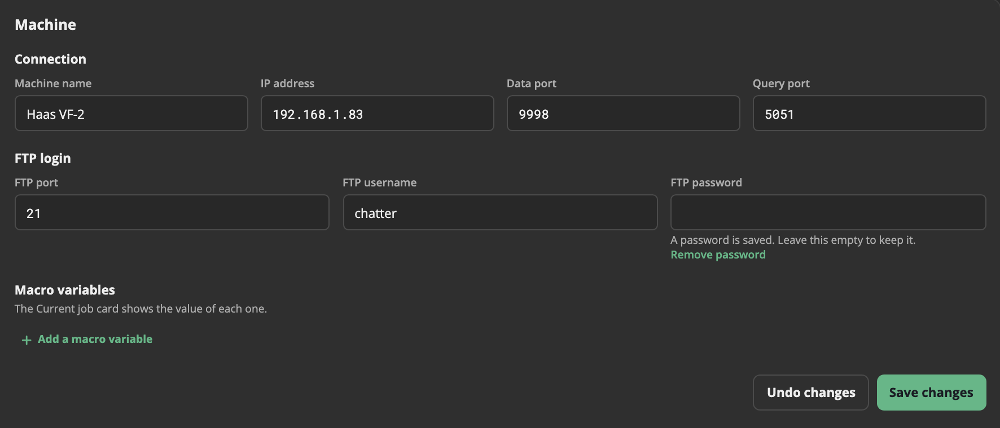

# Get started

## 1. Create the Admin login

Open Chatter in a browser. On the first visit, Chatter asks for a username and a password. This first account is an **Admin**.

::: danger Warning:
Do this at once. Until then, anyone who opens Chatter can make the Admin.
:::

## 2. Add your machines

On the first start, **Find machines** opens by itself. It scans your network for machines. You can also click **Add machine** on the **Machines** page, and type the machine type, a name and the IP address.

::: info If Find machines finds nothing:
It guesses the address range from the address in your browser. If you open Chatter with a name, such as `chatter.local` or `localhost`, type the range, for example `192.168.1`.
:::

For FANUC machines, see [FANUC machines](./fanuc.md).

When you add a machine, it shows on the **Machines** page. It shows **Connecting** until Chatter reaches it, for at most 30 seconds. If Chatter cannot reach it in that time, it shows **Offline**.

If a machine shows **Offline**, open the machine, then **Settings** > **Connection**, and click **Test connection**. See [If a machine shows Offline](./diagnostics.md#if-a-machine-shows-offline).

### If a machine shows Offline

The **Alarm** column on the **Machines** page tells why Chatter cannot reach the machine. The page of the machine shows the same text at the top.

| The text | What to do |
|----------|------------|
| `Unable to connect: Connection timeout`, or `connect EHOSTUNREACH` | Chatter cannot find the machine on the network. Make sure that the machine is on. Compare the IP address on the control with the IP address in Chatter. Shortly after Chatter starts, the network is possibly not ready yet. Wait one minute. |
| `connect ECONNREFUSED` | The machine is on the network, but the port is closed. Turn on the protocol on the control, and check the port in **Settings > Machine**. |
| `The machine accepts the connection, but it does not answer` | Possibly another program is connected to the machine. A Brother control serves only one program at a time. Find the other program and stop it. It can be a second Chatter, for example a test copy on a computer, or other monitoring software. If you cannot find it, turn the control off and on again. |
| `The machine did not answer all requests in 10 seconds` | The machine or the network was too slow, so Chatter stopped the poll. Chatter disconnected. It will connect again. If this text shows again and again, check the network cable and the network switch between Chatter and the machine. |
| `The connection closed before the machine answered` | The connection closed during a request. The machine closed it, or Chatter closed it after a poll timeout. Chatter will connect again. If this text shows again and again, make sure that the machine is on and that its network cable is connected. |

A Pi on the network cannot see which other program is connected to the machine. To find it, look at each computer that can connect to the machine.

### The tool table of a Brother

The tool table of a Brother is a large read, so Chatter does not read it in each poll. Chatter reads it:

- When the machine runs no program, and the last read is more than 10 minutes old. Chatter never reads it automatically while a program runs. If the control sends no run state, Chatter reads it only when the spindle is stopped.
- When you click **Sync** in the **Tool table** tab of the machine. This also works while a program runs. Chatter accepts one **Sync** in 30 seconds for each machine. This limit is for all users together, not for each user.

The tab shows the time of the last read, for example **Synced 10:42 AM**, or **Not synced yet** before the first read. The format of the time follows the language settings of your browser. Until the next read, the tab shows the last values. If a read fails, the tab shows why.

## 3. Set up FTP on each machine

Chatter uses FTP to show, send and download the program files on a machine. Do these steps for each machine:

1. On the **Machines** page, click the machine.
2. Click the **Settings** tab. The **Machine** section is at the top.
3. Under **FTP login**, type the FTP port, username and password that the machine uses. Most machines use port `21`.
4. Click **Save changes**.

Chatter never shows a saved password again. To keep it, leave the password box empty.

You can send at most 32 MB of program files at one time. A Raspberry Pi has little memory, and Chatter holds the files in memory while it sends them. To send more, send the files in smaller groups.

### Delete a machine

An **Admin** can delete a machine from Chatter. Chatter then stops reading the machine and deletes its spindle speed history. You cannot undo this.

1. Click the **Settings** tab of the machine.
2. In the **Delete machine** panel at the bottom, click **Delete machine**.
3. In the box, type `DELETE`. Then click **Delete the machine**.

## 4. Add users and give them roles

Go to **Settings > Users and roles**, and click **Add user**. Give each person a role:

| Role | Can do |
|------|--------|
| **Viewer** | See the machines and their history. Download files. |
| **Operator** | All that a Viewer can do. Send files to the machines, and delete files on them. |
| **Admin** | All that an Operator can do. Add, change, and delete machines. Manage the users and the settings. Update Chatter. |

Give the username and the password to the person. They can change the password on **Settings > Your account**.

Use Chatter only on a shop network that you trust. Do not open it to the internet. See [Security](../security.md).
